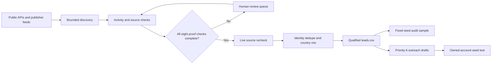

# IncuBrix Multi-Channel Lead Generation & Outreach Engine

[](https://www.python.org/)
[](#verification)
[](#qualification-contract)
[](http://incubrix-longtail.eastasia.cloudapp.azure.com/)

An auditable creator-research engine built for the IncuBrix Growth Engineer Option 1 assessment.
It discovers real creators, measures recent publishing activity, preserves source evidence, routes
uncertain records to human review, prepares multi-channel outreach, and produces reproducible audit
artifacts.

LIVE LINK : http://incubrix-outreach-engine.eastasia.cloudapp.azure.com/

> **Truthful status:** the repository and review tooling are operational. The research pool contains
> 5,000 unique-name candidates. The user has attested to reviewing the first 4,720, but the
> attestation does not replace missing evidence or a live-source recheck. Only rows that pass every
> gate can enter the official `leads.csv`.

## Quick start

### One production command

From the project root on Windows with Python 3.12 or newer:

```powershell
powershell -NoProfile -ExecutionPolicy Bypass -File .\Run-Submission.ps1
```

This command creates the environment when needed, installs locked dependencies, runs tests and
lint, executes the available production sources, preserves evidence, and generates the review,
audit, workbook, outreach and launch artifacts.

Optional API credentials belong in a local Git-ignored `.env` copied from `.env.example`. Missing
optional credentials disable that provider; they never weaken qualification rules. Never commit,
log or paste credentials into a workbook.

### Open the project

| Need | Open or run |
|---|---|
| Understand the handoff | [`START_HERE.md`](START_HERE.md) |
| Review the 5,000 candidates | `IncuBrix_Manual_Review_5000_USER_ATTESTED.xlsx` |
| Follow the review workflow | [`MANUAL_REVIEW_5000.md`](MANUAL_REVIEW_5000.md) |
| Open the local evidence desk | `output/current.html` |
| Start the local dashboard | `.\Run-Project.ps1 -Action dashboard` |
| View the public project overview | [Azure deployment](http://incubrix-longtail.eastasia.cloudapp.azure.com/) |

## Measured project status

| Measurement | Current value |
|---|---:|
| Unique-name review candidates | 5,000 |
| Podcast candidates | 4,177 |
| YouTube candidates | 823 |
| User-attested review rows | 4,720 |
| Attested rows with all eight stored proof pairs | 1 |
| Attested rows still missing one or more stored proof pairs | 4,719 |
| Automated tests | 106 passing |
| User-rejected creators excluded from the pool | 2 |

The 5,000 rows are a real discovery and research pool, not 5,000 automatically qualified leads.
Unknown values remain blank. Discovery hints never silently become approvals.

## How it works



### Source coverage

- **Apple Podcasts and publisher RSS** provide real platform IDs, feed URLs and dated episodes.
- **Podcast Index and publisher websites** expand discovery and support source verification.
- **YouTube Data API** provides real channels and dated public video activity.
- **Tavily**, when configured, provides bounded research hints only; search results cannot qualify a
  creator.
- **Codex-assisted work** is disclosed in `docs/tools-and-disclosure.md`.

## Qualification contract

A creator reaches `leads.csv` only after every mandatory check passes:

1. A real individual creator identity with a canonical public URL.
2. Creator-specific country evidence for US, CA, GB, IE, AU, NZ or SG.
3. Mainly English content.
4. At least 8 distinct dated items in 30 days, or 2 long-form items in 60 days.
5. The creator's own commercial offer or monetization activity.
6. A specific, source-supported IncuBrix content-workflow need.
7. A public business-purpose contact with evidence of activity in the previous 60 days.
8. A genuinely different backup contact route.
9. Eight working evidence URLs with short exact excerpts and fresh retrieval metadata.
10. Stable-ID and identity deduplication plus the required country mix.

The engine rejects stale sources, missing excerpts, copied contacts without business context,
future-dated activity, duplicate content, invalid URLs, and equivalent primary/backup routes.

## Human review

The reviewed copy is `IncuBrix_Manual_Review_5000_USER_ATTESTED.xlsx`.

- `ATTESTATION_SUMMARY` explains exactly what the user approved.
- `REVIEW_INDEX` records `Approve` for ranks 1–4,720 and leaves the remaining 280 unset.
- `Candidates` contains readable discovery facts and source links.
- `Reviews` is the importable evidence sheet and remains proof-gated.

The attestation workflow intentionally records a human verdict separately from engine
qualification. It never invents missing evidence. See
[`docs/user-attestation-20261031.md`](docs/user-attestation-20261031.md).

## Outputs

Each complete run writes a timestamped folder under `output/runs/`. `output/CURRENT_RUN.json`
points to the latest complete run, and `output/current.html` opens its evidence desk.

| Artifact | Purpose |
|---|---|
| `leads.csv` | Evidence-complete, source-rechecked approved rows only |
| `review_queue.csv` / `.json` | Unresolved real candidates; values can be research hints |
| `rejections.csv` | Excluded candidates and explicit reasons |
| `evidence_ledger.csv` | Claim-level URLs, excerpts, retrieval dates and outreach fields |
| `rejection_report.json` | Counts by reason, source and country plus mix checks |
| `audit_sample_*.csv` | Reproducible fixed-seed sample for independent verdicts |
| `audit_dashboard.html` | Responsive searchable evidence desk |
| `runtime_cost_report.json` | Measured runtime, request and cache statistics |
| `outreach/` | Priority A and segment/channel sequences |
| `launch-kit.md` | Conditional 30-day operating plan and assumptions |

## Useful commands

```powershell
# Environment setup
.\Run-Project.ps1 -Action setup

# Full tests and lint
.\Run-Project.ps1 -Action verify

# Production research run
.\Run-Project.ps1 -Action run

# Recheck only evidence-reviewed records
.\Run-Project.ps1 -Action run -ReviewedOnly

# Local evidence dashboard
.\Run-Project.ps1 -Action dashboard

# Submission package
.\Run-Project.ps1 -Action package
```

Exit code `0` means the configured gates pass. Exit code `2` means the engine finished and exported
honest results, but one or more submission gates remain unmet. Any other non-zero exit is an
operational failure.

## Evidence desk UI

The dashboard is dependency-free and works offline. It provides:

- responsive light/dark themes and accessible keyboard focus;
- search, status, country and platform filters;
- status quick filters, sorting and adjustable page size;
- source links and expandable evidence detail;
- safe filtered CSV export;
- exact separation of qualified, pending and rejected records.

Run it privately by default:

```powershell
python -m incubrix_engine serve --port 8080
```

The server refuses a non-loopback bind unless `--allow-public` is explicit. The real evidence desk
can contain public business contacts and should be placed behind authenticated HTTPS. The public
Azure page intentionally exposes aggregate project measurements only.

## Azure deployment

The privacy-safe public overview is deployed with Nginx from `deploy/public/`:

```bash
bash deploy/deploy_vm.sh
```

The deployment is idempotent, tests the Nginx configuration before reloading, adds restrictive
security headers, and publishes a `/health.json` endpoint. The live hostname is
`incubrix-longtail.eastasia.cloudapp.azure.com`.

This deployment currently uses HTTP. It serves the static project overview and health endpoint;
the private evidence desk and engine jobs are not hosted as a web application. HTTPS and an
authenticated review application remain separate deployment work.

## Owned-account seed test

The seed tooling schedules messages, creates first-party tracking links, records evidence and
suppresses follow-ups after replies. It **never sends messages automatically**. Run the three
channel tests only between accounts owned by the candidate.

```powershell
python -m incubrix_engine seed report
```

Use [`docs/seed-test-runbook.md`](docs/seed-test-runbook.md) and capture scheduling, delivery, click
and reply screenshots. A software test does not prove that an actual seed message was delivered.

## Verification

```powershell
python -m pytest --junitxml=verification/tests.xml
python -m ruff check src tests scripts
```

The suite covers evidence gates, duplicate activity, stale-cache provenance, redirects, URL and
spreadsheet safety, review import atomicity, identity routing, country-mix validation, seed
scheduling, click/reply logging, failure recovery, the dashboard, attestation workflow and public
deployment assets.

## Security and data integrity

- Secrets are read from environment variables or the local ignored `.env` only.
- Local/private and reserved URLs are blocked during evidence retrieval.
- HTTP retries, host concurrency, response sizes and candidate deadlines are bounded.
- Cached source bytes retain retrieval metadata and content hashes.
- Failed refreshes are marked degraded and cannot satisfy approval.
- Publisher text is escaped before HTML or spreadsheet export.
- The package builder excludes secrets, databases, checkpoints and local account configuration.
- No real creator has been contacted by the engine.

## Repository map

```text
src/incubrix_engine/   Core pipelines, qualification, review and export logic
tests/                 Isolated automated tests using synthetic .test fixtures
config/                Versioned non-secret configuration
inputs/                Preserved discovery inputs
docs/                  Review, audit, seed, video and disclosure runbooks
deploy/                Privacy-safe public site and Nginx deployment
scripts/               Verification, packaging and maintenance tools
assets/                Official workbook template
```

## Candidate-only completion items

The engine cannot truthfully manufacture these assessment requirements:

- five observations from actually using IncuBrix;
- three product or growth opportunities;
- three owned-account seed tests with screenshots;
- the final independent 40-row audit after a qualified `leads.csv` exists;
- one product walkthrough video and one technical demonstration video;
- declaration and reviewer access details.

See [`docs/requirements-status.md`](docs/requirements-status.md) and
[`docs/video-runbook.md`](docs/video-runbook.md).

## AI and source disclosure

OpenAI Codex assisted with implementation, research automation, source inspection, documentation
and message drafting. Public API metadata and publisher RSS access do not grant a licence to
republish media. The candidate must review the work, be able to explain it, and submit only claims
supported by the evidence ledger.
